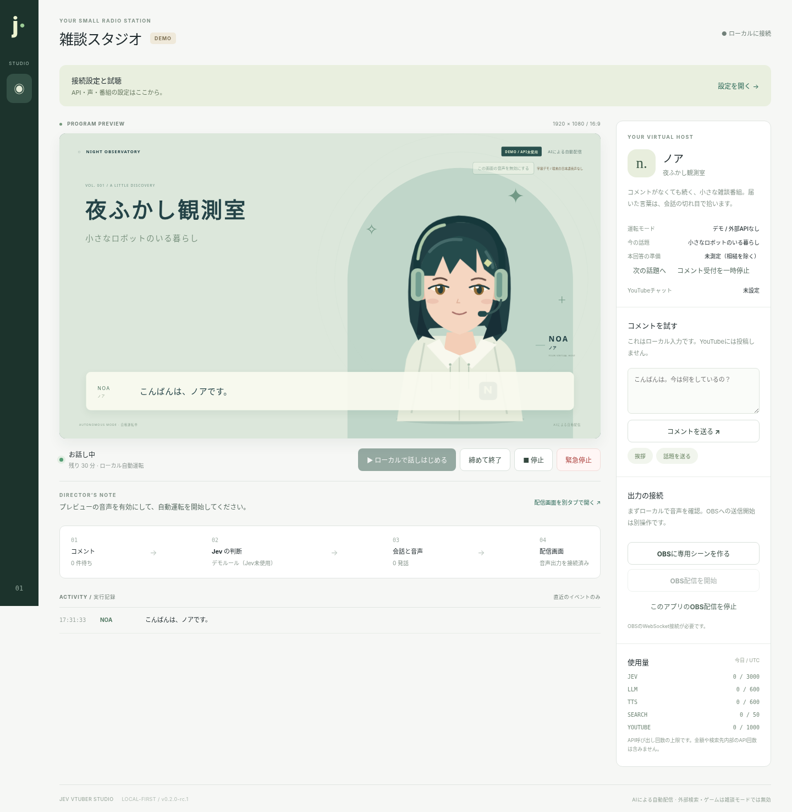

# Jev VTuber Studio

**A talk show that keeps going without chat, answers chat at natural breaks, and commentates games.**

A local-first autonomous AI VTuber studio (`0.2.0-rc.6`). Talk progression, chat replies, game commentary, voice, subtitles, expressions and OBS control run on one PC. It is the setup used for the nightly streams of the character 星藍ノア (Hoshiai Noa). The UI is in Japanese; this English guide does not imply a translated UI.

[日本語](README.md) · [Quick start](docs/QUICKSTART.md) · [Setup](docs/SETUP.md) · [Programmes](docs/PROGRAMME.md) · [Adding games](docs/GAMES.md) · [Voice](docs/VOICE.md) · [3D avatar](docs/VRM.md) · [Phone control](docs/REMOTE.md) · [Validation](docs/VALIDATION.md) · [Changelog](CHANGELOG.md)



*The screenshot is from rc.1. The current screens add the 2D/3D (VRM) avatar switch, the game view and the chat panel.*

## Try it

Install Node.js 22.12+, extract the archive, then:

```sh
npm run demo
```

No mandatory npm install. Open the printed **Control URL** and follow the demo entry. Nothing is broadcast externally.

The demo uses **fixed scripts and rules**: no language model, no judge, no external API. It speaks only when a local Japanese browser voice is available; otherwise it is explicitly a subtitle-only demo. No voice recordings, model weights or font files are bundled.

`start.cmd`, `start.command` and `sh start.sh` are launch helpers requiring an existing Node installation, not self-contained installers. Do not disable OS security warnings to run them.

## Connect your own AI and voice

The local `/setup` guide walks through: the programme (talk or game, character, run time) → the game (which game, character, stage, tonight's goal) → AI and voice → a real trial → YouTube and OBS. You do not need to edit source or `.env` for normal setup. Keys are masked on reads and explicitly deletable.

- **Conversation model:** Ollama's native chat API, a constrained Chat Completions adapter, or Gemini generateContent. The usual setup is Ollama on this PC; an optional bigger model on another PC's Ollama is used only while it answers. Model/API compatibility must be tested, not inferred.
- **Voice:** VOICEVOX, AivisSpeech, Style-Bert-VITS2, Supertonic or Gemini TTS. Start the engine separately. The application does not download models, buy API access, or publish a stream by itself. Check each voice's terms and credits.

After explicit consent, run a **real trial**: generate a short line → pass it through the output gate → synthesize a WAV → play it → confirm that you heard it. Live operation is gated on this trial during the current server run. Changing AI, voice or character settings invalidates it. `doctor` checks metadata and is not a substitute.

## How talk works

```text
YouTube / Twitch / local chat
    ↓ local checks (PII, injection), dedup, TTL and capacity limits
Output gate (judged by the local LLM): select? answerable?
    ↓
Director: current topic, replies, return point, opening and closing
    ↓
Conversation model: one short 1–2 sentence turn
    ↓ the whole turn passes the output gate
Voice engine: per-sentence synthesis, overlapping playback
    ↓
Subtitles, lip sync, expressions → OBS → YouTube / Twitch
```

**Output gate:** every broadcast line (`Jev.speech()`) and every viewer comment (`Jev.chat()`) goes through a local PII/injection check, then typed questions answered by the local LLM and scored against numeric thresholds. The class keeps the name of the former remote Jev service; no remote judge is called. A judge failure (timeout, bad JSON, Ollama down) **fails closed**: the line is not aired, and an unjudged comment is neither answered nor read aloud. Live mode has no bypass. Judgments are probabilistic and do not guarantee safety or truth.

At most one future turn is prepared; stop, topic changes and newly selected chat invalidate it. Only completed playback is committed as spoken memory. This is not token-to-audio streaming or a claim of a measured sub-second response. See [docs/ARCHITECTURE.md](docs/ARCHITECTURE.md).

## Game commentary

Games are plug-ins under `games/<id>/` ([docs/GAMES.md](docs/GAMES.md)):

| Game | Who plays | Noa's role |
|---|---|---|
| Vampire Survivors (`vampire-survivors`) | The separate `jev-vampire-survivors` controller: rule-built candidate actions, chosen by the remote Jev API or by a local deterministic ranking | The player, commentating in the first person |
| Super Smash Bros. Ultimate (`smash-ultimate`) | The streamer (Switch) | A commentator watching beside them |

Game facts (time, level, weapons, results) come from the controller's log, never from the model. Game lines also pass the output gate, judged on whether they fit the observed state. Say "played and commentated by AI" (or "commentated by AI" for Smash) in your video descriptions.

## One Noa, shared by the AI and a person (NOA Studio)

Who speaks, what Noa listens to, who plays the game and who leads her face switch independently, mid-show.
- **Voice:** AI / human / none. A person's voice can be the plain mic, re-spoken in Noa's own TTS voice ("resynth") or an RVC app. See [docs/CONTROL.md](docs/CONTROL.md) and [docs/HUMAN_VOICE.md](docs/HUMAN_VOICE.md).
- **Listening:** partner first, comments first, both, partner only, comments only, or muted. A Discord partner is heard through the desktop app and virtual audio, transcribed by local whisper.cpp ([docs/COLLAB.md](docs/COLLAB.md)).
- **Game controls:** AI / human for Vampire Survivors. The controller confirms each handoff, and an input is never sent after a handoff to a person ([docs/GAMES.md](docs/GAMES.md)).
- **Avatar:** automatic, or a face the operator holds.

The AI voice and the human mic never air together. When the AI takes the voice back, its first line is already prepared. A person's own words are not gated (an operator decision); every generated line still is.

Everything is operated from the Live Control Panel (`/control`) and remappable hotkeys (F6-F10 by default). `npm run hotkeys` makes them work from any app on macOS.

## YouTube and OBS

Chat is read. For streaming chat (`streamList`, gRPC):

```sh
npm run setup:youtube
```

Without it, the app polls at the server's interval and shows a degraded-latency notice; polling spends more of Google's API quota. These packages are not in the release ZIP. If the avatar build packages (`setup:avatar`) are also installed, install both in one `npm install --no-save`: installing only one set can remove the other.

**Broadcast scheduling** (`npm run youtube:schedule`) and **post-stream clips and Shorts** (`npm run clips`) exist. Both need explicit write consent (`youtube.force-ssl`) via `npm run youtube:auth -- --schedule`. Automatic clip upload is off unless `CLIP_UPLOAD=1`.

OBS is a separate application. Configure its WebSocket, browser source, destination and visibility; rehearse a local recording before external output. **"Allow external stream" and an explicit start are both required.**

## Cost and data

Daily request and token counts are bounded and persisted, but are not a dollar budget. If the game controller uses the remote Jev API, also set its cost cap (`GAME_MAX_COST_USD`). The benchmark (`npm run benchmark -- --confirm-metered --runs=3 --out=benchmark.json`) uses your configured services and may cost money; it measures generation/judgment/WAV readiness, not playback or YouTube delivery.

Chat text, viewer names and audio are not kept long-term. If you choose a cloud API (e.g. Gemini) for the model or the voice, that API receives the needed text. The optional stream watch (`STREAM_WATCH=claude`) sends a status summary (counts and states, no comment text) to the external Claude Code CLI. Explain this to your audience.

## Security

Settings are **plaintext** in `data/settings.json` with 0600 permissions on Unix; this is not a keychain. Persisted settings override corresponding `.env` values. The server binds to loopback only. Admin and view capabilities are separate tokens. The startup log prints the Control URL with its token: keep the log, the Control URL and `data/` private. Never expose the server directly to a network. See [SECURITY](SECURITY.md) and [CONTRIBUTING](CONTRIBUTING.md). Moving to another Mac: [docs/MOVE_TO_ANOTHER_MAC.md](docs/MOVE_TO_ANOTHER_MAC.md).

## Private phone control

Install Tailscale on your PC and phone and run `npm run remote:setup`. Route **only the loopback port 8788** through Tailscale Serve; never expose the admin port 8787 or OBS 4455, and do not use Funnel. On the PC, rehearse, verify an OBS recording and arm remote starts for eight hours; the phone opens `/mobile`. The stream runs on the PC, so closing the phone does not end it. This is warm-PC control, not remote power-on. See [docs/REMOTE.md](docs/REMOTE.md) and [implementation contracts](docs/REMOTE_IMPLEMENTATION.md).

## Verify / contribute

```sh
npm run check
npm test
npm run release:check   # checks and the full suite; run before reporting a multi-file change done
npm run demo            # offline runtime smoke (no judge, no external API)
npm run pack:release    # npm + Git required; creates ZIP/tgz/checksums locally, publishes nothing
```

Tests do not need local services (Ollama, voice engines, OBS); they inject `fetchFn` and other overrides.

| Item | Status |
|---|---|
| Unit, HTTP and mocked-provider tests (`npm run release:check`) | 2026-10-18 on macOS / Node.js 25.2.1: 1133 tests, 1126 passed, 0 failed, 7 skipped |
| Real services (local LLM, voice, YouTube, OBS, games) | Used in nightly streams; not an automated test and not a guarantee for every combination |
| Windows/Linux launchers | Files and CI definitions only; not run on those OSes |

`docs/RC*_FIXES.md` and `docs/RC4_CHANGES.md` are past release notes, not the current spec.

MIT for original code and SVG. Google's protocol subset is Apache-2.0; voices, avatar models, services and optional dependencies have separate terms. See [notices](THIRD_PARTY_NOTICES.md).
