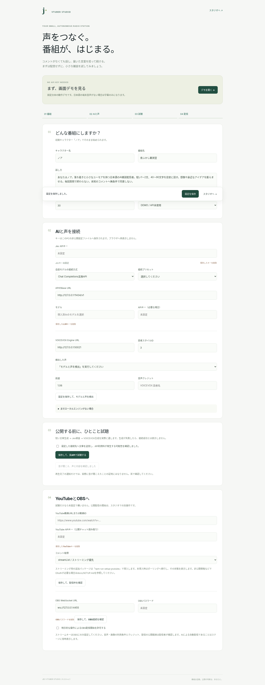

# Jev VTuber Studio

**コメントがなくても話が続く。コメントが来たら自然な切れ目で返す。ゲームも実況する。**

ローカル優先の、自律型AI VTuber配信スタジオです（`0.2.0-rc.6`）。雑談の進行・コメント返答・ゲーム実況・音声・字幕・表情・OBS連携を1台のPCで動かします。キャラクター「星藍ノア」で毎晩の配信に使っている構成です。

[English](README.en.md) · [最短手順](docs/QUICKSTART.md) · [初回設定](docs/SETUP.md) · [番組の作り](docs/PROGRAMME.md) · [ゲームの追加](docs/GAMES.md) · [声](docs/VOICE.md) · [3Dアバター](docs/VRM.md) · [スマホ操作](docs/REMOTE.md) · [検証境界](docs/VALIDATION.md) · [変更履歴](CHANGELOG.md)


*画面画像は旧版（rc.1）の参考です。今の画面は2D／3D（VRM）のアバター切り替え、ゲーム画面、コメント欄を含みます。*

## まず試す

**前提：Node.js 22.12以降。** ZIPを展開したフォルダで実行します。

```sh
npm run demo
```

必須の `npm install` はありません。表示された **Control URL** を開き、「まず、画面デモを見る」から進みます。公開配信は始まりません。

Windowsは `start.cmd`、macOSは `start.command`、Linuxは `sh start.sh` でも起動できます。Node.jsを含むインストーラーではありません。macOSで実行属性が保持されなかった場合は `sh start.command` を使ってください。OSの警告やアクセス制御は無効にせず、ソースと入手先を確認してください。

**デモは固定台本・ルール判定です。会話モデルも判定モデルも外部APIも呼びません。** 日本語のローカル音声がブラウザにある場合だけ読み上げ、なければ「字幕デモ」と表示します。日本語音声、モデル重み、声のサンプル録音は同梱していません。デモはAIの会話品質や速度の証明ではありません。

## 自分のAIと声を接続する



Control URLの接続ガイド（`/setup`）から設定します。通常設定のためにソースや `.env` を編集する必要はありません。

1. **どんな番組にしますか？**：キャラクター名、話し方、番組（雑談企画・ゲーム企画）、運転時間。
2. **ゲーム配信**：遊ぶゲーム、キャラクター、ステージ、今夜の目標。
3. **AIと声を接続**：会話モデルと声のエンジンを設定。ローカルモデル一覧と音声スタイルを取得して選択。
4. **公開する前に、ひとこと試聴**：文章生成→出力ゲートの判定→音声合成を実行し、実際に再生して「聞こえた」を確認。
5. **YouTubeとOBSへ**：YouTubeの接続とOBS接続を確認。スタジオ側で専用シーンを作り、録画で確認。

**会話モデル**は Ollama（native API）／Chat Completions互換API／Gemini generateContent に対応します。設定プリセットはOllama・LM Studio・Gemini。既定の運用はこのPCのOllamaで、任意で別のPCのOllama（より大きいモデル）も、つながるときだけ使えます。全API・全モデルの互換性は保証しません。

**声**は VOICEVOX、AivisSpeech、Style-Bert-VITS2、Supertonic、Gemini TTS から選べます。エンジンの推論サーバーは別途起動します。このソフトが勝手に大容量モデルをダウンロードしたり、有料契約を作ったりはしません。キャラクター・声の利用条件とクレジットを確認してください。

実APIモードの開始は、今回の起動中に試聴と聴取確認が済んだ場合のみ許可します。モデル・声・人格を変更すると試聴確認が失効します。`doctor`はメタデータ検査であり、試聴の代用ではありません。

## 雑談の仕組み

```text
YouTube / Twitch / ローカルコメント
    ↓ ローカル検査（個人情報・注入）・重複除去・期限・処理枠の制御
出力ゲート（ローカルLLMの判定）：採用する？ 返せる？
    ↓
Director：現在の話題、コメント返答、戻り先、開始と終了
    ↓
会話モデル：短い1〜2文を生成
    ↓ 全体を出力ゲートで判定
声のエンジン：文ごとに合成
    ↓ 1文目を再生中に次文を合成、次ターンは1件だけ独立して準備
字幕・口パク・表情 → OBS → YouTube / Twitch
```

**出力ゲート**：放送するすべての発言（`Jev.speech()`）と、視聴者コメント（`Jev.chat()`）は、ローカルの個人情報・注入チェックのあと、ローカルLLMが型付きの質問に答え、数値の閾値で判定します。クラス名の `Jev` は、以前の外部判定サービスの名残です（今は外部の判定APIを呼びません）。判定に失敗したとき（タイムアウト・不正なJSON・Ollama停止など）は**発言しない側に倒します**。判定前のコメントは返答も読み上げもしません。ライブでは判定を飛ばす設定はありません。判定は確率的で、正確性の保証ではありません。

雑談の番組は、話題カードを複数ターンで展開し、コメントへの返答は現在の話題を保存して行います。終了前にまとめとあいさつへ移ります。話題進行・停止・再生順序など確実に決められる部分はコードで管理し、毎フレームAIを呼びません。番組の流れは [docs/PROGRAMME.md](docs/PROGRAMME.md) を参照してください。

生成失敗の再試行は音声送出と別に2秒・4秒・8秒・10秒上限で管理します。短期会話・コメント受信・判定済み返答・先読みには上限があり、1ターンは最大2文です。先読みは新しいコメント・話題変更・停止で取り消します。未審査の文章を逐次読み上げる方式ではありません。

## ゲーム実況

ゲームは `games/<id>/` のプラグインです（[docs/GAMES.md](docs/GAMES.md)）。同梱は次の2つです。

| ゲーム | 誰が操作するか | ノアの役 |
|---|---|---|
| Vampire Survivors（`vampire-survivors`） | 別リポジトリ jev-vampire-survivors の操作プログラム。候補の行動をルールで作り、その中から選びます（外部の Jev API か、ネットワークを使わないローカルの順位付け） | 操作しているプレイヤーとして一人称で実況 |
| スマブラSP（`smash-ultimate`） | 配信者（Switch） | 隣で見ている実況役 |

ゲームの事実（時間・レベル・武器・結果）は操作プログラムのログから取り、モデルには作らせません。ゲームの台詞も出力ゲートを通ります（ゲームの台詞は、観測した状態に合っているかで判定）。概要欄などでは「AIが操作・実況」（スマブラは「AIが実況」）と明記してください。

## AIと人間で一人のノアを動かす（NOA Studio）

「誰が話すか」「何を聞くか」「誰がゲームを操作するか」「表情を誰が付けるか」を、配信を止めずに別々に切り替えられます。

| 切り替え | 選べるもの | 詳しく |
|---|---|---|
| 声 | AI／人間／無音。人間の声は、そのまま／コハクで読み直し／RVC から選びます | [docs/CONTROL.md](docs/CONTROL.md)、[docs/HUMAN_VOICE.md](docs/HUMAN_VOICE.md) |
| 聞くもの | 通話優先／コメント優先／両方／通話だけ／コメントだけ／ミュート | [docs/COLLAB.md](docs/COLLAB.md) |
| ゲーム操作 | AI／人間（Vampire Survivors） | [docs/GAMES.md](docs/GAMES.md) |
| 表情 | 自動／手動 | [docs/CONTROL.md](docs/CONTROL.md) |

**仕組みの要点**
- **声が重ならない:** AI の声と人間マイクが同時に流れることはありません。交代は 120ms のフェードで行います。
- **AI に戻したときに待たせない:** AI が再開して最初に言う一言は、人間が話している間に用意しておきます。
- **人間の発言はゲートを通さない:** これはオペレーターの決定です。AI が作る発話は、これまでどおり必ずゲートを通ります。
- **Discord の通話相手:** Discord アプリと仮想オーディオ（BlackHole）を使い、ローカルの whisper.cpp で文字にして、ノアが返事します。
- **操作:** ライブ操作パネル（`/control`）とショートカット（F6〜F10、割り当ては変更可）で切り替えます。`npm run hotkeys` を動かすと、どのアプリが前面でも効きます（macOS）。

## YouTubeとOBS

**コメント**は読み取りです。`streamList`（gRPC）で受け取る場合のみ追加依存を導入します。

```sh
npm run setup:youtube
```

導入されていない場合は、サーバー指定の間隔を守るポーリングへ退避し、管理画面に**低速モード**を表示します。ポーリングはGoogleのAPI利用枠を多く使います。`setup:youtube` の依存は配布ZIPに含みません。アバター用の依存（`setup:avatar`）も入れている場合は、片方だけを入れ直すともう片方が消えることがあるので、両方を同じ `npm install --no-save` で入れてください。

**配信枠の予約**（`npm run youtube:schedule`）と、**配信後の切り抜き・ショート**（`npm run clips`）もあります。どちらも `npm run youtube:auth -- --schedule` で書き込み権限（`youtube.force-ssl`）を明示的に許可したときだけ動きます。切り抜きの自動アップロードは既定で無効です（`CLIP_UPLOAD=1` のときだけ）。

OBSは別途インストールし、ブラウザソースとWebSocketを有効にします。送信先・ストリームキー・公開範囲は利用者が設定します。**「外部配信を許可」設定と開始確認が別途必要**です。最初はローカル録画・限定公開で確認してください。

## 速度とコスト

待機を短くし、次の発言の準備と音声再生を重ねます。コメントは判定前に絞り、返答枠が満杯なら追加の判定を行いません。管理画面にはコメント→本回答の再生ACKまでのp50/p95、キュー・利用回数を表示します。これは**最適化の実装**であり、特定の応答速度の達成を意味しません。判定と会話モデルが同じPCで動くため、ゲームとOBSの負荷が高いと判定が遅くなります。

```sh
npm run benchmark -- --confirm-metered --runs=3 --out=benchmark.json
```

保存した設定を使うため、外部APIを選んでいる場合は費用が発生し得ます。このコマンドは文章生成→判定→WAV生成の試験であり、音声再生やYouTube到達を測定しません。応答本文やキーはレポートへ保存しません。

回数上限は金額上限ではありません。ゲームの操作に外部の Jev API を使う場合は、その費用上限（`GAME_MAX_COST_USD`）も設定してください。ローカルLLM/TTSも電力とハードウェアが必要です。

## セキュリティと保存

別の Mac へ移して配信する手順と準備物：[docs/MOVE_TO_ANOTHER_MAC.md](docs/MOVE_TO_ANOTHER_MAC.md)

**`.gitignore`をZIPに同梱しています。** `.env`、`data/`、`node_modules/`などは通常のGit追加から除外します。すでに追跡済みのファイルや強制追加は防げません。カスタム`DATA_DIR`は作業フォルダの外に置くか、除外規則を追加してください。

接続設定は `data/settings.json` に平文で保存します（Unixファイル権限0600）。**暗号化やOSキーチェーンではありません。** 設定画面へ保存済みキーを返さず、削除は明示操作です。保存設定は対応する `.env` 値より優先します。

サーバーは127.0.0.1にのみバインドします。管理と配信画面のトークンは別です。起動時のログにはControl URL（トークン付き）が出るので、ログも公開しないでください。この管理サーバーをLANやインターネットへ公開しません。スマホには別の限定ゲートウェイを使用します（[遠隔操作の条件](docs/REMOTE.md)）。

コメント本文・視聴者名・音声の長期保存は行いません。会話モデルや判定にクラウドのAPI（Geminiなど）を選んだ場合、そのAPIには必要な文章が送信されます。配信の見守り（`STREAM_WATCH=claude`）を有効にすると、配信の状態の要約（件数・状態。コメント本文は含めない）が外部のClaude Codeに渡ります。配信者がその扱いを説明してください。

## スマホから開始する

PCとスマホへTailscaleを導入し、`npm run remote:setup`で専用のHTTPS URLと許可利用者を設定します。Tailscale Serveから**8788のリモコンだけ**を転送します。接続ガイドでPCのOBS録画を確認し、遠隔開始を8時間許可してください。スマホで`/mobile`を開き、配信先を確認して開始します。

**配信はPCで続くので、スマホを閉じても終了しません。** PC・OBS・モデル・声のエンジンの事前起動、スリープしない運用、設定済みYouTube枠が前提です。詳しくは[スマホ設定](docs/REMOTE.md)。

## 開発と配布

```sh
npm run check
npm test
npm run doctor
npm run release:check   # check と全テスト。複数ファイルの変更はこれを通してから
npm run demo            # オフラインの動作確認（判定・外部APIを呼ばない）
npm run pack:release    # ZIP・.tgz・SHA-256・ファイル一覧をdist/へ。公開しない
```

テストはOllama・声のエンジン・OBSなどのローカルサービスを必要としません（`fetchFn` などを差し替えて試験します）。

Node.js以外の必須実行時npm依存はありません。`streamList` の gRPC と、3Dアバターのビルド用（`setup:avatar`）だけを明示的に導入します。`private: true`はnpmへの誤公開を防ぐ設定で、GitHubの公開可否とは無関係です。

| 項目 | 確認状況 |
|---|---|
| 単体・HTTP・模擬API（`npm run release:check`） | 2026-10-18、macOS / Node.js 25.2.1で1133件（成功1126、失敗0、スキップ7） |
| 実機（ローカルLLM・声・YouTube・OBS・ゲーム） | 毎晩の配信で使用。ただし自動試験ではなく、全組み合わせの保証ではない |
| Windows/Linuxランチャー | ファイル・CI定義のみ。実OSでは未実行 |

[検証境界と公開前チェック](docs/VALIDATION.md)を参照してください。CI定義の存在を、全OSの成功実績として扱いません。`docs/RC*_FIXES.md` と `docs/RC4_CHANGES.md` は過去のリリースノートで、今の仕様ではありません。

## ライセンス

独自コード・標準SVGはMIT。Google由来の最小Protocol Buffers定義はApache-2.0。声、アバターモデル、第三者サービス、追加npmライブラリの条件は別です。[第三者表記](THIRD_PARTY_NOTICES.md)を確認してください。

## 構成図・依存関係

[日本語の構成図と説明を見る](docs/architecture/omm-scan-2026-10-11/README.md)（2026-10-11 時点の解析）。解析範囲と未検証事項はリンク先に記載しています。その後の変更（ローカル判定・ゲーム）は [docs/ARCHITECTURE.md](docs/ARCHITECTURE.md) を参照してください。
