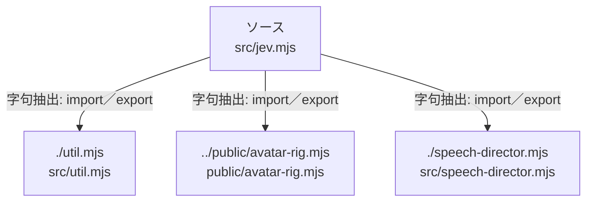

# dependency-map/group-1/n-src-jev-mjs-b727cf

[解析トップへ戻る](../../../README.md)

確認済みファイル: `src/jev.mjs`

解析: 字句抽出。静的なimport／export参照です。関数の実行順序やHTTP通信は表していません。

宣言: `validateAnswers`, `Jev`, `Effects`

- `./util.mjs` → `src/util.mjs`（内容確認済み）
- `../public/avatar-rig.mjs` → `public/avatar-rig.mjs`（一覧確認・内容未読）
- `./speech-director.mjs` → `src/speech-director.mjs`（一覧確認・内容未読）

## 要素の説明

### n-public-avatar-rig-mjs-66f0d0

参照名: `../public/avatar-rig.mjs`

対応する実在ソース: `public/avatar-rig.mjs`。内容は未読。

### n-speech-director-mjs-efaa27

参照名: `./speech-director.mjs`

対応する実在ソース: `src/speech-director.mjs`。内容は未読。

### n-util-mjs-c035dc

参照名: `./util.mjs`

対応する実在ソース: `src/util.mjs`。内容確認済み。

### source

`src/jev.mjs` の内容を確認しました。

