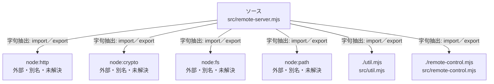

# dependency-map/group-1/n-src-remote-server-mjs-8db3b3

[解析トップへ戻る](../../../README.md)

確認済みファイル: `src/remote-server.mjs`

解析: 字句抽出。静的なimport／export参照です。関数の実行順序やHTTP通信は表していません。

宣言: `validateRemoteOptions`, `loadRemoteOptions`, `readBody`, `createRemoteServer`

- `node:http` → 外部・標準ライブラリ・別名など。ローカル対応先は未確定
- `node:crypto` → 外部・標準ライブラリ・別名など。ローカル対応先は未確定
- `node:fs` → 外部・標準ライブラリ・別名など。ローカル対応先は未確定
- `node:path` → 外部・標準ライブラリ・別名など。ローカル対応先は未確定
- `./util.mjs` → `src/util.mjs`（内容確認済み）
- `./remote-control.mjs` → `src/remote-control.mjs`（内容確認済み）

## 要素の説明

### n-node-crypto-c7dfc5

参照名: `node:crypto`

ローカルのソース対応先を確定できませんでした。外部ライブラリ、標準ライブラリ、型別名などを区別する追加確認が必要です。

### n-node-fs-a15b7d

参照名: `node:fs`

ローカルのソース対応先を確定できませんでした。外部ライブラリ、標準ライブラリ、型別名などを区別する追加確認が必要です。

### n-node-http-e4ddf5

参照名: `node:http`

ローカルのソース対応先を確定できませんでした。外部ライブラリ、標準ライブラリ、型別名などを区別する追加確認が必要です。

### n-node-path-78811c

参照名: `node:path`

ローカルのソース対応先を確定できませんでした。外部ライブラリ、標準ライブラリ、型別名などを区別する追加確認が必要です。

### n-remote-control-mjs-39bf24

参照名: `./remote-control.mjs`

対応する実在ソース: `src/remote-control.mjs`。内容確認済み。

### n-util-mjs-c035dc

参照名: `./util.mjs`

対応する実在ソース: `src/util.mjs`。内容確認済み。

### source

`src/remote-server.mjs` の内容を確認しました。

