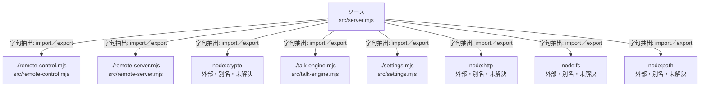

# dependency-map/group-1/n-src-server-mjs-ecbaf6/imports-1

[解析トップへ戻る](../../../../README.md)

import参照の表示用グループ。

## 要素の説明

### n-node-crypto-c7dfc5

参照名: `node:crypto`

ローカルのソース対応先を確定できませんでした。外部ライブラリ、標準ライブラリ、型別名などを区別する追加確認が必要です。

### n-node-fs-a15b7d

参照名: `node:fs`

ローカルのソース対応先を確定できませんでした。外部ライブラリ、標準ライブラリ、型別名などを区別する追加確認が必要です。

### n-node-http-e4ddf5

参照名: `node:http`

ローカルのソース対応先を確定できませんでした。外部ライブラリ、標準ライブラリ、型別名などを区別する追加確認が必要です。

### n-node-path-78811c

参照名: `node:path`

ローカルのソース対応先を確定できませんでした。外部ライブラリ、標準ライブラリ、型別名などを区別する追加確認が必要です。

### n-remote-control-mjs-39bf24

参照名: `./remote-control.mjs`

対応する実在ソース: `src/remote-control.mjs`。内容確認済み。

### n-remote-server-mjs-87fec3

参照名: `./remote-server.mjs`

対応する実在ソース: `src/remote-server.mjs`。内容確認済み。

### n-settings-mjs-ae44d9

参照名: `./settings.mjs`

対応する実在ソース: `src/settings.mjs`。内容確認済み。

### n-talk-engine-mjs-2e96ca

参照名: `./talk-engine.mjs`

対応する実在ソース: `src/talk-engine.mjs`。内容確認済み。

### source

`src/server.mjs` の内容を確認しました。

