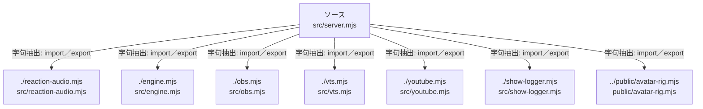

# dependency-map/group-1/n-src-server-mjs-ecbaf6/imports-3

[解析トップへ戻る](../../../../README.md)

import参照の表示用グループ。

## 要素の説明

### n-engine-mjs-4b278b

参照名: `./engine.mjs`

対応する実在ソース: `src/engine.mjs`。内容確認済み。

### n-obs-mjs-31928f

参照名: `./obs.mjs`

対応する実在ソース: `src/obs.mjs`。内容は未読。

### n-public-avatar-rig-mjs-66f0d0

参照名: `../public/avatar-rig.mjs`

対応する実在ソース: `public/avatar-rig.mjs`。内容は未読。

### n-reaction-audio-mjs-0e2238

参照名: `./reaction-audio.mjs`

対応する実在ソース: `src/reaction-audio.mjs`。内容確認済み。

### n-show-logger-mjs-1ee80e

参照名: `./show-logger.mjs`

対応する実在ソース: `src/show-logger.mjs`。内容は未読。

### n-vts-mjs-09e764

参照名: `./vts.mjs`

対応する実在ソース: `src/vts.mjs`。内容は未読。

### n-youtube-mjs-1df363

参照名: `./youtube.mjs`

対応する実在ソース: `src/youtube.mjs`。内容は未読。

### source

`src/server.mjs` の内容を確認しました。

