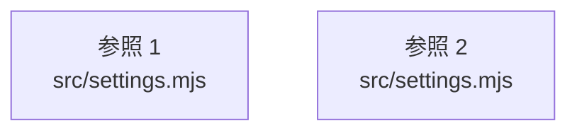

# dependency-map/group-1/n-src-settings-mjs-c9e9af

[解析トップへ戻る](../../../README.md)

確認済みファイル: `src/settings.mjs`

解析: 字句抽出。静的なimport／export参照です。関数の実行順序やHTTP通信は表していません。

宣言: `videoID`, `publicSettings`, `SettingsValidationError`, `settingText`, `saveSettings`, `diagnosticError`, `detect`, `rehearse`

- `node:fs` → 外部・標準ライブラリ・別名など。ローカル対応先は未確定
- `node:path` → 外部・標準ライブラリ・別名など。ローカル対応先は未確定
- `./config.mjs` → `src/config.mjs`（一覧確認・内容未読）
- `./util.mjs` → `src/util.mjs`（内容確認済み）
- `./providers.mjs` → `src/providers.mjs`（内容確認済み）
- `./voice-routing.mjs` → `src/voice-routing.mjs`（内容確認済み）
- `./jev.mjs` → `src/jev.mjs`（内容確認済み）
- `./director.mjs` → `src/director.mjs`（一覧確認・内容未読）
- `./voice-router.mjs` → `src/voice-router.mjs`（内容確認済み）
- `./speech-director.mjs` → `src/speech-director.mjs`（一覧確認・内容未読）
- `./reaction-audio.mjs` → `src/reaction-audio.mjs`（内容確認済み）
- `./audio-bus.mjs` → `src/audio-bus.mjs`（一覧確認・内容未読）
- `./tts-adapters.mjs` → `src/tts-adapters.mjs`（一覧確認・内容未読）

## 要素の説明

### imports-1

import参照の表示用グループ。

[詳細な図と説明を見る](imports-1/README.md)

### imports-2

import参照の表示用グループ。

[詳細な図と説明を見る](imports-2/README.md)

