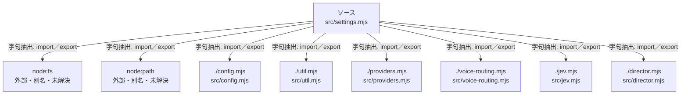

# dependency-map/group-1/n-src-settings-mjs-c9e9af/imports-1

[解析トップへ戻る](../../../../README.md)

import参照の表示用グループ。

## 要素の説明

### n-config-mjs-f9f8e1

参照名: `./config.mjs`

対応する実在ソース: `src/config.mjs`。内容は未読。

### n-director-mjs-7bc8b4

参照名: `./director.mjs`

対応する実在ソース: `src/director.mjs`。内容は未読。

### n-jev-mjs-0dca39

参照名: `./jev.mjs`

対応する実在ソース: `src/jev.mjs`。内容確認済み。

### n-node-fs-a15b7d

参照名: `node:fs`

ローカルのソース対応先を確定できませんでした。外部ライブラリ、標準ライブラリ、型別名などを区別する追加確認が必要です。

### n-node-path-78811c

参照名: `node:path`

ローカルのソース対応先を確定できませんでした。外部ライブラリ、標準ライブラリ、型別名などを区別する追加確認が必要です。

### n-providers-mjs-f20ed0

参照名: `./providers.mjs`

対応する実在ソース: `src/providers.mjs`。内容確認済み。

### n-util-mjs-c035dc

参照名: `./util.mjs`

対応する実在ソース: `src/util.mjs`。内容確認済み。

### n-voice-routing-mjs-c5fb9a

参照名: `./voice-routing.mjs`

対応する実在ソース: `src/voice-routing.mjs`。内容確認済み。

### source

`src/settings.mjs` の内容を確認しました。

