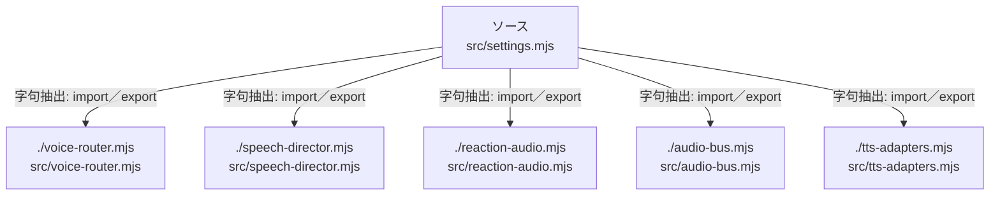

# dependency-map/group-1/n-src-settings-mjs-c9e9af/imports-2

[解析トップへ戻る](../../../../README.md)

import参照の表示用グループ。

## 要素の説明

### n-audio-bus-mjs-d297e0

参照名: `./audio-bus.mjs`

対応する実在ソース: `src/audio-bus.mjs`。内容は未読。

### n-reaction-audio-mjs-0e2238

参照名: `./reaction-audio.mjs`

対応する実在ソース: `src/reaction-audio.mjs`。内容確認済み。

### n-speech-director-mjs-efaa27

参照名: `./speech-director.mjs`

対応する実在ソース: `src/speech-director.mjs`。内容は未読。

### n-tts-adapters-mjs-fe5b43

参照名: `./tts-adapters.mjs`

対応する実在ソース: `src/tts-adapters.mjs`。内容は未読。

### n-voice-router-mjs-a12943

参照名: `./voice-router.mjs`

対応する実在ソース: `src/voice-router.mjs`。内容確認済み。

### source

`src/settings.mjs` の内容を確認しました。

