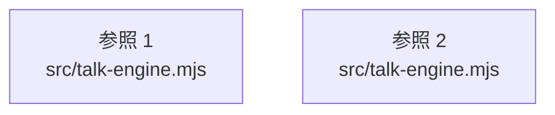

# dependency-map/group-1/n-src-talk-engine-mjs-4a1e77

[解析トップへ戻る](../../../README.md)

確認済みファイル: `src/talk-engine.mjs`

解析: 字句抽出。静的なimport／export参照です。関数の実行順序やHTTP通信は表していません。

宣言: `voiceStats`, `TalkEngine`

- `node:crypto` → 外部・標準ライブラリ・別名など。ローカル対応先は未確定
- `./engine.mjs` → `src/engine.mjs`（内容確認済み）
- `./director.mjs` → `src/director.mjs`（一覧確認・内容未読）
- `./metrics.mjs` → `src/metrics.mjs`（一覧確認・内容未読）
- `./content-quality.mjs` → `src/content-quality.mjs`（一覧確認・内容未読）
- `./show-logger.mjs` → `src/show-logger.mjs`（一覧確認・内容未読）
- `./util.mjs` → `src/util.mjs`（内容確認済み）
- `./tts-adapters.mjs` → `src/tts-adapters.mjs`（一覧確認・内容未読）
- `./blocks-show.mjs` → `src/blocks-show.mjs`（一覧確認・内容未読）
- `./speech-director.mjs` → `src/speech-director.mjs`（一覧確認・内容未読）
- `./audio-bus.mjs` → `src/audio-bus.mjs`（一覧確認・内容未読）

## 要素の説明

### imports-1

import参照の表示用グループ。

[詳細な図と説明を見る](imports-1/README.md)

### imports-2

import参照の表示用グループ。

[詳細な図と説明を見る](imports-2/README.md)

