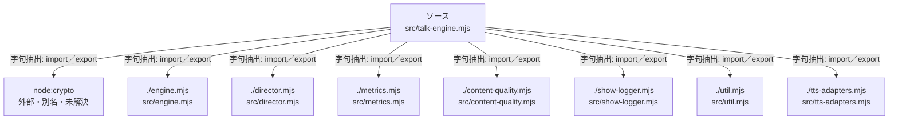

# dependency-map/group-1/n-src-talk-engine-mjs-4a1e77/imports-1

[解析トップへ戻る](../../../../README.md)

import参照の表示用グループ。

## 要素の説明

### n-content-quality-mjs-f33eb1

参照名: `./content-quality.mjs`

対応する実在ソース: `src/content-quality.mjs`。内容は未読。

### n-director-mjs-7bc8b4

参照名: `./director.mjs`

対応する実在ソース: `src/director.mjs`。内容は未読。

### n-engine-mjs-4b278b

参照名: `./engine.mjs`

対応する実在ソース: `src/engine.mjs`。内容確認済み。

### n-metrics-mjs-b94fb9

参照名: `./metrics.mjs`

対応する実在ソース: `src/metrics.mjs`。内容は未読。

### n-node-crypto-c7dfc5

参照名: `node:crypto`

ローカルのソース対応先を確定できませんでした。外部ライブラリ、標準ライブラリ、型別名などを区別する追加確認が必要です。

### n-show-logger-mjs-1ee80e

参照名: `./show-logger.mjs`

対応する実在ソース: `src/show-logger.mjs`。内容は未読。

### n-tts-adapters-mjs-fe5b43

参照名: `./tts-adapters.mjs`

対応する実在ソース: `src/tts-adapters.mjs`。内容は未読。

### n-util-mjs-c035dc

参照名: `./util.mjs`

対応する実在ソース: `src/util.mjs`。内容確認済み。

### source

`src/talk-engine.mjs` の内容を確認しました。

