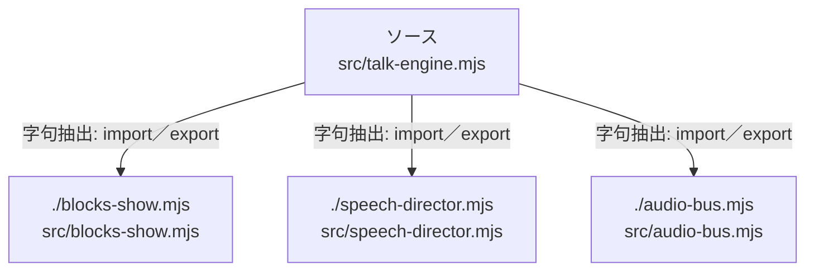

# dependency-map/group-1/n-src-talk-engine-mjs-4a1e77/imports-2

[解析トップへ戻る](../../../../README.md)

import参照の表示用グループ。

## 要素の説明

### n-audio-bus-mjs-d297e0

参照名: `./audio-bus.mjs`

対応する実在ソース: `src/audio-bus.mjs`。内容は未読。

### n-blocks-show-mjs-56ec3d

参照名: `./blocks-show.mjs`

対応する実在ソース: `src/blocks-show.mjs`。内容は未読。

### n-speech-director-mjs-efaa27

参照名: `./speech-director.mjs`

対応する実在ソース: `src/speech-director.mjs`。内容は未読。

### source

`src/talk-engine.mjs` の内容を確認しました。

