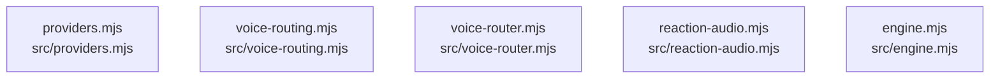

# dependency-map/group-2

[解析トップへ戻る](../../README.md)

このグループは表示用の区切りです。独立した実行モジュールではありません。

## 要素の説明

### n-src-engine-mjs-b1133c

確認済みファイル: `src/engine.mjs`

解析: 字句抽出。静的なimport／export参照です。関数の実行順序やHTTP通信は表していません。

宣言: `Engine`

- `node:events` → 外部・標準ライブラリ・別名など。ローカル対応先は未確定
- `node:crypto` → 外部・標準ライブラリ・別名など。ローカル対応先は未確定
- `./util.mjs` → `src/util.mjs`（内容確認済み）
- `./store.mjs` → `src/store.mjs`（内容確認済み）
- `./jev.mjs` → `src/jev.mjs`（内容確認済み）
- `./game.mjs` → `src/game.mjs`（一覧確認・内容未読）
- `../public/avatar-rig.mjs` → `public/avatar-rig.mjs`（一覧確認・内容未読）
- `../public/voice-acting.mjs` → `public/voice-acting.mjs`（一覧確認・内容未読）

[詳細な図と説明を見る](n-src-engine-mjs-b1133c/README.md)

### n-src-providers-mjs-df56e3

確認済みファイル: `src/providers.mjs`

解析: 字句抽出。静的なimport／export参照です。関数の実行順序やHTTP通信は表していません。

宣言: `wavDuration`, `Conversation`, `Voice`, `parseResearchLines`, `Research`

- `./director.mjs` → `src/director.mjs`（一覧確認・内容未読）
- `./util.mjs` → `src/util.mjs`（内容確認済み）

[詳細な図と説明を見る](n-src-providers-mjs-df56e3/README.md)

### n-src-reaction-audio-mjs-b09e29

確認済みファイル: `src/reaction-audio.mjs`

解析: 字句抽出。静的なimport／export参照です。関数の実行順序やHTTP通信は表していません。

宣言: `normalizePhrase`, `validatePhraseText`, `allowEntry`, `loadPhraseAllowlist`, `readManifest`, `readEntryFile`, `checkBytes`, `checkLevels`, `checkClip`, `checkClipAudio`, `checkPhrase`, `checkPhraseAudio`, `acceptClip`, `acceptPhrase`, `fingerprintOf`, `scan`, `ReactionAudioCache`, `ensureDir`, `writeAtomic`, `writeManifestAtomic`, `writeManifestChecked`, `openLibrary`, `addClip`, `addPhrase`, `removeEntry`

- `node:fs` → 外部・標準ライブラリ・別名など。ローカル対応先は未確定
- `node:path` → 外部・標準ライブラリ・別名など。ローカル対応先は未確定
- `./util.mjs` → `src/util.mjs`（内容確認済み）
- `./director.mjs` → `src/director.mjs`（一覧確認・内容未読）
- `./config.mjs` → `src/config.mjs`（一覧確認・内容未読）
- `../public/avatar-rig.mjs` → `public/avatar-rig.mjs`（一覧確認・内容未読）
- `./wav.mjs` → `src/wav.mjs`（一覧確認・内容未読）

[詳細な図と説明を見る](n-src-reaction-audio-mjs-b09e29/README.md)

### n-src-voice-router-mjs-fb3a96

確認済みファイル: `src/voice-router.mjs`

解析: 字句抽出。静的なimport／export参照です。関数の実行順序やHTTP通信は表していません。

宣言: `CircuitBreaker`, `splitText`, `planUnits`, `toBus`, `VoiceQualityRouter`, `DirectedVoice`, `themselves`

- `./voice-routing.mjs` → `src/voice-routing.mjs`（内容確認済み）
- `./tts-adapters.mjs` → `src/tts-adapters.mjs`（一覧確認・内容未読）
- `./audio-bus.mjs` → `src/audio-bus.mjs`（一覧確認・内容未読）
- `./wav.mjs` → `src/wav.mjs`（一覧確認・内容未読）
- `./speech-director.mjs` → `src/speech-director.mjs`（一覧確認・内容未読）
- `../public/voice-acting.mjs` → `public/voice-acting.mjs`（一覧確認・内容未読）
- `./util.mjs` → `src/util.mjs`（内容確認済み）
- `./cloud-spend.mjs` → `src/cloud-spend.mjs`（一覧確認・内容未読）

[詳細な図と説明を見る](n-src-voice-router-mjs-fb3a96/README.md)

### n-src-voice-routing-mjs-93b9d1

確認済みファイル: `src/voice-routing.mjs`

解析: 字句抽出。静的なimport／export参照です。関数の実行順序やHTTP通信は表していません。

宣言: `CommentVoice`, `SupertonicVoice`, `ReplyVoice`

- `./providers.mjs` → `src/providers.mjs`（内容確認済み）
- `./util.mjs` → `src/util.mjs`（内容確認済み）

[詳細な図と説明を見る](n-src-voice-routing-mjs-93b9d1/README.md)

