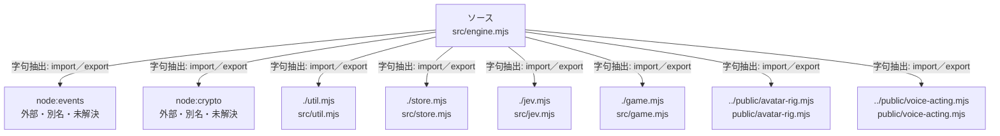

# dependency-map/group-2/n-src-engine-mjs-b1133c

[解析トップへ戻る](../../../README.md)

確認済みファイル: `src/engine.mjs`

解析: 字句抽出。静的なimport／export参照です。関数の実行順序やHTTP通信は表していません。

宣言: `Engine`

- `node:events` → 外部・標準ライブラリ・別名など。ローカル対応先は未確定
- `node:crypto` → 外部・標準ライブラリ・別名など。ローカル対応先は未確定
- `./util.mjs` → `src/util.mjs`（内容確認済み）
- `./store.mjs` → `src/store.mjs`（内容確認済み）
- `./jev.mjs` → `src/jev.mjs`（内容確認済み）
- `./game.mjs` → `src/game.mjs`（一覧確認・内容未読）
- `../public/avatar-rig.mjs` → `public/avatar-rig.mjs`（一覧確認・内容未読）
- `../public/voice-acting.mjs` → `public/voice-acting.mjs`（一覧確認・内容未読）

## 要素の説明

### n-game-mjs-1236a6

参照名: `./game.mjs`

対応する実在ソース: `src/game.mjs`。内容は未読。

### n-jev-mjs-0dca39

参照名: `./jev.mjs`

対応する実在ソース: `src/jev.mjs`。内容確認済み。

### n-node-crypto-c7dfc5

参照名: `node:crypto`

ローカルのソース対応先を確定できませんでした。外部ライブラリ、標準ライブラリ、型別名などを区別する追加確認が必要です。

### n-node-events-bd2727

参照名: `node:events`

ローカルのソース対応先を確定できませんでした。外部ライブラリ、標準ライブラリ、型別名などを区別する追加確認が必要です。

### n-public-avatar-rig-mjs-66f0d0

参照名: `../public/avatar-rig.mjs`

対応する実在ソース: `public/avatar-rig.mjs`。内容は未読。

### n-public-voice-acting-mjs-7aeb57

参照名: `../public/voice-acting.mjs`

対応する実在ソース: `public/voice-acting.mjs`。内容は未読。

### n-store-mjs-6caec8

参照名: `./store.mjs`

対応する実在ソース: `src/store.mjs`。内容確認済み。

### n-util-mjs-c035dc

参照名: `./util.mjs`

対応する実在ソース: `src/util.mjs`。内容確認済み。

### source

`src/engine.mjs` の内容を確認しました。

