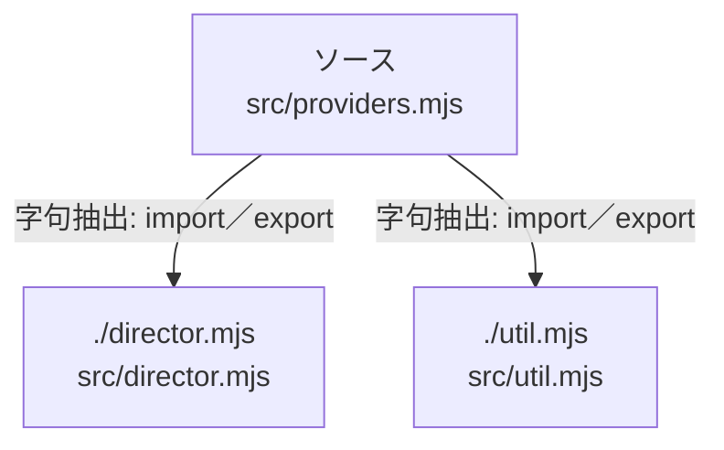

# dependency-map/group-2/n-src-providers-mjs-df56e3

[解析トップへ戻る](../../../README.md)

確認済みファイル: `src/providers.mjs`

解析: 字句抽出。静的なimport／export参照です。関数の実行順序やHTTP通信は表していません。

宣言: `wavDuration`, `Conversation`, `Voice`, `parseResearchLines`, `Research`

- `./director.mjs` → `src/director.mjs`（一覧確認・内容未読）
- `./util.mjs` → `src/util.mjs`（内容確認済み）

## 要素の説明

### n-director-mjs-7bc8b4

参照名: `./director.mjs`

対応する実在ソース: `src/director.mjs`。内容は未読。

### n-util-mjs-c035dc

参照名: `./util.mjs`

対応する実在ソース: `src/util.mjs`。内容確認済み。

### source

`src/providers.mjs` の内容を確認しました。

