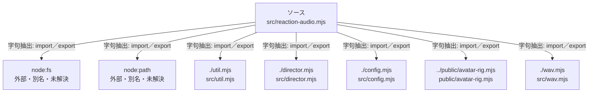

# dependency-map/group-2/n-src-reaction-audio-mjs-b09e29

[解析トップへ戻る](../../../README.md)

確認済みファイル: `src/reaction-audio.mjs`

解析: 字句抽出。静的なimport／export参照です。関数の実行順序やHTTP通信は表していません。

宣言: `normalizePhrase`, `validatePhraseText`, `allowEntry`, `loadPhraseAllowlist`, `readManifest`, `readEntryFile`, `checkBytes`, `checkLevels`, `checkClip`, `checkClipAudio`, `checkPhrase`, `checkPhraseAudio`, `acceptClip`, `acceptPhrase`, `fingerprintOf`, `scan`, `ReactionAudioCache`, `ensureDir`, `writeAtomic`, `writeManifestAtomic`, `writeManifestChecked`, `openLibrary`, `addClip`, `addPhrase`, `removeEntry`

- `node:fs` → 外部・標準ライブラリ・別名など。ローカル対応先は未確定
- `node:path` → 外部・標準ライブラリ・別名など。ローカル対応先は未確定
- `./util.mjs` → `src/util.mjs`（内容確認済み）
- `./director.mjs` → `src/director.mjs`（一覧確認・内容未読）
- `./config.mjs` → `src/config.mjs`（一覧確認・内容未読）
- `../public/avatar-rig.mjs` → `public/avatar-rig.mjs`（一覧確認・内容未読）
- `./wav.mjs` → `src/wav.mjs`（一覧確認・内容未読）

## 要素の説明

### n-config-mjs-f9f8e1

参照名: `./config.mjs`

対応する実在ソース: `src/config.mjs`。内容は未読。

### n-director-mjs-7bc8b4

参照名: `./director.mjs`

対応する実在ソース: `src/director.mjs`。内容は未読。

### n-node-fs-a15b7d

参照名: `node:fs`

ローカルのソース対応先を確定できませんでした。外部ライブラリ、標準ライブラリ、型別名などを区別する追加確認が必要です。

### n-node-path-78811c

参照名: `node:path`

ローカルのソース対応先を確定できませんでした。外部ライブラリ、標準ライブラリ、型別名などを区別する追加確認が必要です。

### n-public-avatar-rig-mjs-66f0d0

参照名: `../public/avatar-rig.mjs`

対応する実在ソース: `public/avatar-rig.mjs`。内容は未読。

### n-util-mjs-c035dc

参照名: `./util.mjs`

対応する実在ソース: `src/util.mjs`。内容確認済み。

### n-wav-mjs-370333

参照名: `./wav.mjs`

対応する実在ソース: `src/wav.mjs`。内容は未読。

### source

`src/reaction-audio.mjs` の内容を確認しました。

