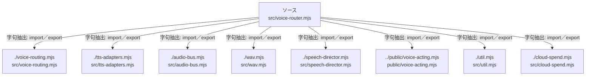

# dependency-map/group-2/n-src-voice-router-mjs-fb3a96

[解析トップへ戻る](../../../README.md)

確認済みファイル: `src/voice-router.mjs`

解析: 字句抽出。静的なimport／export参照です。関数の実行順序やHTTP通信は表していません。

宣言: `CircuitBreaker`, `splitText`, `planUnits`, `toBus`, `VoiceQualityRouter`, `DirectedVoice`, `themselves`

- `./voice-routing.mjs` → `src/voice-routing.mjs`（内容確認済み）
- `./tts-adapters.mjs` → `src/tts-adapters.mjs`（一覧確認・内容未読）
- `./audio-bus.mjs` → `src/audio-bus.mjs`（一覧確認・内容未読）
- `./wav.mjs` → `src/wav.mjs`（一覧確認・内容未読）
- `./speech-director.mjs` → `src/speech-director.mjs`（一覧確認・内容未読）
- `../public/voice-acting.mjs` → `public/voice-acting.mjs`（一覧確認・内容未読）
- `./util.mjs` → `src/util.mjs`（内容確認済み）
- `./cloud-spend.mjs` → `src/cloud-spend.mjs`（一覧確認・内容未読）

## 要素の説明

### n-audio-bus-mjs-d297e0

参照名: `./audio-bus.mjs`

対応する実在ソース: `src/audio-bus.mjs`。内容は未読。

### n-cloud-spend-mjs-96f450

参照名: `./cloud-spend.mjs`

対応する実在ソース: `src/cloud-spend.mjs`。内容は未読。

### n-public-voice-acting-mjs-7aeb57

参照名: `../public/voice-acting.mjs`

対応する実在ソース: `public/voice-acting.mjs`。内容は未読。

### n-speech-director-mjs-efaa27

参照名: `./speech-director.mjs`

対応する実在ソース: `src/speech-director.mjs`。内容は未読。

### n-tts-adapters-mjs-fe5b43

参照名: `./tts-adapters.mjs`

対応する実在ソース: `src/tts-adapters.mjs`。内容は未読。

### n-util-mjs-c035dc

参照名: `./util.mjs`

対応する実在ソース: `src/util.mjs`。内容確認済み。

### n-voice-routing-mjs-c5fb9a

参照名: `./voice-routing.mjs`

対応する実在ソース: `src/voice-routing.mjs`。内容確認済み。

### n-wav-mjs-370333

参照名: `./wav.mjs`

対応する実在ソース: `src/wav.mjs`。内容は未読。

### source

`src/voice-router.mjs` の内容を確認しました。

