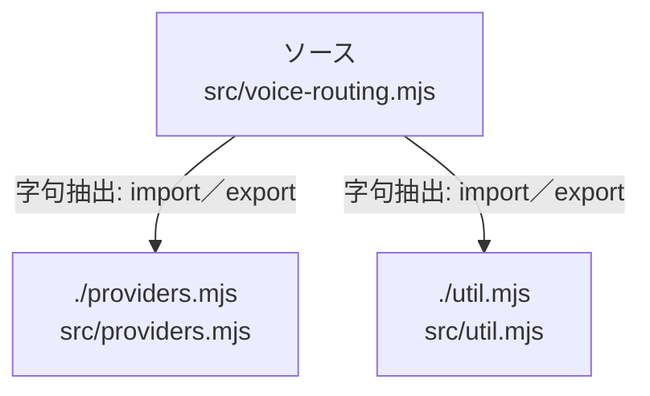

# dependency-map/group-2/n-src-voice-routing-mjs-93b9d1

[解析トップへ戻る](../../../README.md)

確認済みファイル: `src/voice-routing.mjs`

解析: 字句抽出。静的なimport／export参照です。関数の実行順序やHTTP通信は表していません。

宣言: `CommentVoice`, `SupertonicVoice`, `ReplyVoice`

- `./providers.mjs` → `src/providers.mjs`（内容確認済み）
- `./util.mjs` → `src/util.mjs`（内容確認済み）

## 要素の説明

### n-providers-mjs-f20ed0

参照名: `./providers.mjs`

対応する実在ソース: `src/providers.mjs`。内容確認済み。

### n-util-mjs-c035dc

参照名: `./util.mjs`

対応する実在ソース: `src/util.mjs`。内容確認済み。

### source

`src/voice-routing.mjs` の内容を確認しました。

