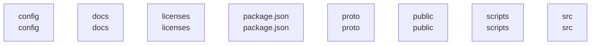

# overall-architecture/group-1

[解析トップへ戻る](../../README.md)

このグループは表示用の区切りです。独立した実行モジュールではありません。

## 要素の説明

### n-config-dfba7a

確認したパス: `config`。配下の登録ファイルは5件。

- `config/character.json`（一覧のみ）
- `config/phrases.json`（一覧のみ）
- `config/programmes.json`（一覧のみ）
- `config/topics.json`（一覧のみ）
- `config/voice-benchmark.json`（一覧のみ）

[詳細な図と説明を見る](n-config-dfba7a/README.md)

### n-docs-71ab8b

確認したパス: `docs`。配下の登録ファイルは27件。

- `docs/ARCHITECTURE.md`（一覧のみ）
- `docs/ART_BRIEF.md`（一覧のみ）
- `docs/AVATAR.md`（一覧のみ）
- `docs/COMMENT_REPLY.md`（一覧のみ）
- `docs/NOA_PARTS_BRIEF.md`（一覧のみ）
- `docs/PROGRAMME.md`（一覧のみ）
- `docs/RC2_FIXES.md`（一覧のみ）
- `docs/RC4_CHANGES.md`（一覧のみ）
- `docs/RC5_FIXES.md`（一覧のみ）
- `docs/REFERENCES.md`（一覧のみ）
- `docs/REMOTE.md`（一覧のみ）
- `docs/REMOTE_IMPLEMENTATION.md`（一覧のみ）
- `docs/SETUP.md`（一覧のみ）
- `docs/UPGRADE.md`（一覧のみ）
- `docs/VALIDATION.md`（一覧のみ）
- `docs/VOICE.md`（一覧のみ）
- `docs/YOUTUBE_TEST.md`（一覧のみ）
- `docs/browser-check.json`（一覧のみ）
- `docs/mobile-preview.png`（一覧のみ）
- `docs/rc2-http-smoke.json`（一覧のみ）
- `docs/remote-browser-check.json`（一覧のみ）
- `docs/remote-test-results.tap`（一覧のみ）
- `docs/setup-mobile.png`（一覧のみ）
- `docs/setup-preview.png`（一覧のみ）
- `docs/stage-preview.png`（一覧のみ）
- `docs/studio-preview.png`（一覧のみ）
- `docs/test-results.tap`（一覧のみ）

[詳細な図と説明を見る](n-docs-71ab8b/README.md)

### n-licenses-a39ea9

確認したパス: `licenses`。配下の登録ファイルは2件。

- `licenses/Apache-2.0.txt`（一覧のみ）
- `licenses/README.md`（一覧のみ）

### n-package-json-7030d0

確認したパス: `package.json`。配下の登録ファイルは1件。

- `package.json`（内容確認済み）

### n-proto-dfe805

確認したパス: `proto`。配下の登録ファイルは1件。

- `proto/stream_list.proto`（一覧のみ）

### n-public-61c9b2

確認したパス: `public`。配下の登録ファイルは52件。

- `public/avatar-rig.mjs`（一覧のみ）
- `public/blocks-core.mjs`（一覧のみ）
- `public/effect-director.mjs`（一覧のみ）
- `public/effects-layer.mjs`（一覧のみ）
- `public/index.html`（一覧のみ）
- `public/layer-avatar.mjs`（一覧のみ）
- `public/mobile-icon.svg`（一覧のみ）
- `public/mobile.css`（一覧のみ）
- `public/mobile.html`（一覧のみ）
- `public/mobile.mjs`（一覧のみ）
- `public/mobile.webmanifest`（一覧のみ）
- `public/models/noa/Blush.png`（一覧のみ）
- `public/models/noa/Body.png`（一覧のみ）
- `public/models/noa/BrowL.png`（一覧のみ）
- `public/models/noa/BrowR.png`（一覧のみ）
- `public/models/noa/EyeClosedL.png`（一覧のみ）
- `public/models/noa/EyeClosedR.png`（一覧のみ）
- `public/models/noa/EyeIrisL.png`（一覧のみ）
- `public/models/noa/EyeIrisR.png`（一覧のみ）
- `public/models/noa/EyeLashL.png`（一覧のみ）
- `public/models/noa/EyeLashR.png`（一覧のみ）
- `public/models/noa/EyeWhiteL.png`（一覧のみ）
- `public/models/noa/EyeWhiteR.png`（一覧のみ）
- `public/models/noa/Face.png`（一覧のみ）
- `public/models/noa/HairSideL.png`（一覧のみ）
- `public/models/noa/HairSideR.png`（一覧のみ）
- `public/models/noa/HeadBase.png`（一覧のみ）
- `public/models/noa/Microphone.png`（一覧のみ）
- `public/models/noa/MouthClosed.png`（一覧のみ）
- `public/models/noa/MouthO.png`（一覧のみ）
- `public/models/noa/MouthOpen.png`（一覧のみ）
- `public/models/noa/MouthWave.png`（一覧のみ）
- `public/models/noa/model.json`（一覧のみ）
- `public/noa-avatar-v4.mjs`（一覧のみ）
- `public/noa-blocks.mjs`（一覧のみ）

[詳細な図と説明を見る](n-public-61c9b2/README.md)

### n-scripts-16728d

確認したパス: `scripts`。配下の登録ファイルは17件。

- `scripts/analyze-log.mjs`（一覧のみ）
- `scripts/benchmark.mjs`（一覧のみ）
- `scripts/browser-render-check.py`（一覧のみ）
- `scripts/build-noa-layers.py`（一覧のみ）
- `scripts/check.mjs`（一覧のみ）
- `scripts/cli.mjs`（一覧のみ）
- `scripts/doctor.mjs`（一覧のみ）
- `scripts/episode-brief.mjs`（一覧のみ）
- `scripts/live-player.mjs`（一覧のみ）
- `scripts/package-release.mjs`（一覧のみ）
- `scripts/remote-setup.mjs`（一覧のみ）
- `scripts/supertonic-local.py`（一覧のみ）
- `scripts/supervised.mjs`（一覧のみ）
- `scripts/voice-benchmark.mjs`（一覧のみ）
- `scripts/voice-design.mjs`（一覧のみ）
- `scripts/voice-library.mjs`（一覧のみ）
- `scripts/youtube-auth.mjs`（一覧のみ）

[詳細な図と説明を見る](n-scripts-16728d/README.md)

### n-src-f27fed

確認したパス: `src`。配下の登録ファイルは31件。

- `src/audio-bus.mjs`（一覧のみ）
- `src/blocks-show.mjs`（一覧のみ）
- `src/cloud-spend.mjs`（一覧のみ）
- `src/config.mjs`（一覧のみ）
- `src/content-quality.mjs`（一覧のみ）
- `src/director.mjs`（一覧のみ）
- `src/engine.mjs`（内容確認済み）
- `src/game.mjs`（一覧のみ）
- `src/jev.mjs`（内容確認済み）
- `src/metrics.mjs`（一覧のみ）
- `src/obs.mjs`（一覧のみ）
- `src/pcm-stream.mjs`（一覧のみ）
- `src/providers.mjs`（内容確認済み）
- `src/reaction-audio.mjs`（内容確認済み）
- `src/remote-control.mjs`（内容確認済み）
- `src/remote-server.mjs`（内容確認済み）
- `src/server.mjs`（内容確認済み）
- `src/settings.mjs`（内容確認済み）
- `src/show-logger.mjs`（一覧のみ）
- `src/speech-director.mjs`（一覧のみ）
- `src/store.mjs`（内容確認済み）
- `src/talk-engine.mjs`（内容確認済み）
- `src/tts-adapters.mjs`（一覧のみ）
- `src/util.mjs`（内容確認済み）
- `src/voice-bench.mjs`（一覧のみ）
- `src/voice-router.mjs`（内容確認済み）
- `src/voice-routing.mjs`（内容確認済み）
- `src/vts.mjs`（一覧のみ）
- `src/wav.mjs`（一覧のみ）
- `src/youtube-stream.mjs`（一覧のみ）
- `src/youtube.mjs`（一覧のみ）

[詳細な図と説明を見る](n-src-f27fed/README.md)

