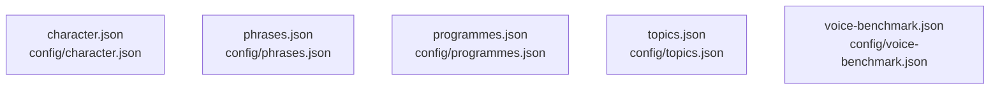

# overall-architecture/group-1/n-config-dfba7a

[解析トップへ戻る](../../../README.md)

確認したパス: `config`。配下の登録ファイルは5件。

- `config/character.json`（一覧のみ）
- `config/phrases.json`（一覧のみ）
- `config/programmes.json`（一覧のみ）
- `config/topics.json`（一覧のみ）
- `config/voice-benchmark.json`（一覧のみ）

## 要素の説明

### n-config-character-json-9cbf22

実在パス: `config/character.json`。1ファイル。

- `config/character.json`

### n-config-phrases-json-5946b5

実在パス: `config/phrases.json`。1ファイル。

- `config/phrases.json`

### n-config-programmes-json-b81336

実在パス: `config/programmes.json`。1ファイル。

- `config/programmes.json`

### n-config-topics-json-74b952

実在パス: `config/topics.json`。1ファイル。

- `config/topics.json`

### n-config-voice-benchmark-json-8a8daf

実在パス: `config/voice-benchmark.json`。1ファイル。

- `config/voice-benchmark.json`

