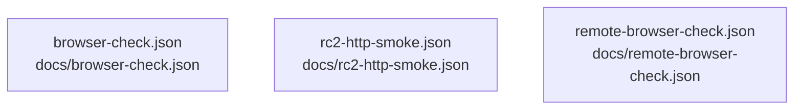

# overall-architecture/group-1/n-docs-71ab8b

[解析トップへ戻る](../../../README.md)

確認したパス: `docs`。配下の登録ファイルは27件。

- `docs/ARCHITECTURE.md`（一覧のみ）
- `docs/ART_BRIEF.md`（一覧のみ）
- `docs/AVATAR.md`（一覧のみ）
- `docs/COMMENT_REPLY.md`（一覧のみ）
- `docs/NOA_PARTS_BRIEF.md`（一覧のみ）
- `docs/PROGRAMME.md`（一覧のみ）
- `docs/RC2_FIXES.md`（一覧のみ）
- `docs/RC4_CHANGES.md`（一覧のみ）
- `docs/RC5_FIXES.md`（一覧のみ）
- `docs/REFERENCES.md`（一覧のみ）
- `docs/REMOTE.md`（一覧のみ）
- `docs/REMOTE_IMPLEMENTATION.md`（一覧のみ）
- `docs/SETUP.md`（一覧のみ）
- `docs/UPGRADE.md`（一覧のみ）
- `docs/VALIDATION.md`（一覧のみ）
- `docs/VOICE.md`（一覧のみ）
- `docs/YOUTUBE_TEST.md`（一覧のみ）
- `docs/browser-check.json`（一覧のみ）
- `docs/mobile-preview.png`（一覧のみ）
- `docs/rc2-http-smoke.json`（一覧のみ）
- `docs/remote-browser-check.json`（一覧のみ）
- `docs/remote-test-results.tap`（一覧のみ）
- `docs/setup-mobile.png`（一覧のみ）
- `docs/setup-preview.png`（一覧のみ）
- `docs/stage-preview.png`（一覧のみ）
- `docs/studio-preview.png`（一覧のみ）
- `docs/test-results.tap`（一覧のみ）

## 要素の説明

### n-docs-browser-check-json-7719aa

実在パス: `docs/browser-check.json`。1ファイル。

- `docs/browser-check.json`

### n-docs-rc2-http-smoke-json-d61e7e

実在パス: `docs/rc2-http-smoke.json`。1ファイル。

- `docs/rc2-http-smoke.json`

### n-docs-remote-browser-check-json-2bd11a

実在パス: `docs/remote-browser-check.json`。1ファイル。

- `docs/remote-browser-check.json`

