# overall-architecture/group-1/n-public-61c9b2/group-1

[解析トップへ戻る](../../../../README.md)

このグループは表示用の区切りです。独立した実行モジュールではありません。

```mermaid
graph TD
    n-public-models-eafb94["models\npublic/models"]
    n-public-avatar-rig-mjs-7748a2["avatar-rig.mjs\npublic/avatar-rig.mjs"]
    n-public-blocks-core-mjs-7cf73d["blocks-core.mjs\npublic/blocks-core.mjs"]
    n-public-effect-director-mjs-24447e["effect-director.mjs\npublic/effect-director.mjs"]
    n-public-effects-layer-mjs-181b69["effects-layer.mjs\npublic/effects-layer.mjs"]
    n-public-index-html-f43ecd["index.html\npublic/index.html"]
    n-public-layer-avatar-mjs-aa0ad8["layer-avatar.mjs\npublic/layer-avatar.mjs"]
    n-public-mobile-html-59d614["mobile.html\npublic/mobile.html"]
```

## 要素の説明

### n-public-avatar-rig-mjs-7748a2

実在パス: `public/avatar-rig.mjs`。1ファイル。

- `public/avatar-rig.mjs`

### n-public-blocks-core-mjs-7cf73d

実在パス: `public/blocks-core.mjs`。1ファイル。

- `public/blocks-core.mjs`

### n-public-effect-director-mjs-24447e

実在パス: `public/effect-director.mjs`。1ファイル。

- `public/effect-director.mjs`

### n-public-effects-layer-mjs-181b69

実在パス: `public/effects-layer.mjs`。1ファイル。

- `public/effects-layer.mjs`

### n-public-index-html-f43ecd

実在パス: `public/index.html`。1ファイル。

- `public/index.html`

### n-public-layer-avatar-mjs-aa0ad8

実在パス: `public/layer-avatar.mjs`。1ファイル。

- `public/layer-avatar.mjs`

### n-public-mobile-html-59d614

実在パス: `public/mobile.html`。1ファイル。

- `public/mobile.html`

### n-public-models-eafb94

実在パス: `public/models`。22ファイル。

- `public/models/noa/Blush.png`
- `public/models/noa/Body.png`
- `public/models/noa/BrowL.png`
- `public/models/noa/BrowR.png`
- `public/models/noa/EyeClosedL.png`
- `public/models/noa/EyeClosedR.png`
- `public/models/noa/EyeIrisL.png`
- `public/models/noa/EyeIrisR.png`
- `public/models/noa/EyeLashL.png`
- `public/models/noa/EyeLashR.png`
- `public/models/noa/EyeWhiteL.png`
- `public/models/noa/EyeWhiteR.png`
- `public/models/noa/Face.png`
- `public/models/noa/HairSideL.png`
- `public/models/noa/HairSideR.png`
- `public/models/noa/HeadBase.png`
- `public/models/noa/Microphone.png`
- `public/models/noa/MouthClosed.png`
- `public/models/noa/MouthO.png`
- `public/models/noa/MouthOpen.png`
- `public/models/noa/MouthWave.png`
- `public/models/noa/model.json`

