# overall-architecture/group-1/n-scripts-16728d

[解析トップへ戻る](../../../README.md)

確認したパス: `scripts`。配下の登録ファイルは17件。

- `scripts/analyze-log.mjs`（一覧のみ）
- `scripts/benchmark.mjs`（一覧のみ）
- `scripts/browser-render-check.py`（一覧のみ）
- `scripts/build-noa-layers.py`（一覧のみ）
- `scripts/check.mjs`（一覧のみ）
- `scripts/cli.mjs`（一覧のみ）
- `scripts/doctor.mjs`（一覧のみ）
- `scripts/episode-brief.mjs`（一覧のみ）
- `scripts/live-player.mjs`（一覧のみ）
- `scripts/package-release.mjs`（一覧のみ）
- `scripts/remote-setup.mjs`（一覧のみ）
- `scripts/supertonic-local.py`（一覧のみ）
- `scripts/supervised.mjs`（一覧のみ）
- `scripts/voice-benchmark.mjs`（一覧のみ）
- `scripts/voice-design.mjs`（一覧のみ）
- `scripts/voice-library.mjs`（一覧のみ）
- `scripts/youtube-auth.mjs`（一覧のみ）

```mermaid
graph TD
    n-scripts-analyze-log-mjs-470445["analyze-log.mjs\nscripts/analyze-log.mjs"]
    n-scripts-benchmark-mjs-0c076b["benchmark.mjs\nscripts/benchmark.mjs"]
    n-scripts-browser-render-check-py-280713["browser-render-check.py\nscripts/browser-render-check.py"]
    n-scripts-build-noa-layers-py-2c7307["build-noa-layers.py\nscripts/build-noa-layers.py"]
    n-scripts-check-mjs-28bba7["check.mjs\nscripts/check.mjs"]
    n-scripts-cli-mjs-50a30e["cli.mjs\nscripts/cli.mjs"]
    n-scripts-doctor-mjs-25baa3["doctor.mjs\nscripts/doctor.mjs"]
    n-scripts-episode-brief-mjs-062431["episode-brief.mjs\nscripts/episode-brief.mjs"]
```

## 要素の説明

### n-scripts-analyze-log-mjs-470445

実在パス: `scripts/analyze-log.mjs`。1ファイル。

- `scripts/analyze-log.mjs`

### n-scripts-benchmark-mjs-0c076b

実在パス: `scripts/benchmark.mjs`。1ファイル。

- `scripts/benchmark.mjs`

### n-scripts-browser-render-check-py-280713

実在パス: `scripts/browser-render-check.py`。1ファイル。

- `scripts/browser-render-check.py`

### n-scripts-build-noa-layers-py-2c7307

実在パス: `scripts/build-noa-layers.py`。1ファイル。

- `scripts/build-noa-layers.py`

### n-scripts-check-mjs-28bba7

実在パス: `scripts/check.mjs`。1ファイル。

- `scripts/check.mjs`

### n-scripts-cli-mjs-50a30e

実在パス: `scripts/cli.mjs`。1ファイル。

- `scripts/cli.mjs`

### n-scripts-doctor-mjs-25baa3

実在パス: `scripts/doctor.mjs`。1ファイル。

- `scripts/doctor.mjs`

### n-scripts-episode-brief-mjs-062431

実在パス: `scripts/episode-brief.mjs`。1ファイル。

- `scripts/episode-brief.mjs`

