# overall-architecture/group-1/n-src-f27fed

[解析トップへ戻る](../../../README.md)

確認したパス: `src`。配下の登録ファイルは31件。

- `src/audio-bus.mjs`（一覧のみ）
- `src/blocks-show.mjs`（一覧のみ）
- `src/cloud-spend.mjs`（一覧のみ）
- `src/config.mjs`（一覧のみ）
- `src/content-quality.mjs`（一覧のみ）
- `src/director.mjs`（一覧のみ）
- `src/engine.mjs`（内容確認済み）
- `src/game.mjs`（一覧のみ）
- `src/jev.mjs`（内容確認済み）
- `src/metrics.mjs`（一覧のみ）
- `src/obs.mjs`（一覧のみ）
- `src/pcm-stream.mjs`（一覧のみ）
- `src/providers.mjs`（内容確認済み）
- `src/reaction-audio.mjs`（内容確認済み）
- `src/remote-control.mjs`（内容確認済み）
- `src/remote-server.mjs`（内容確認済み）
- `src/server.mjs`（内容確認済み）
- `src/settings.mjs`（内容確認済み）
- `src/show-logger.mjs`（一覧のみ）
- `src/speech-director.mjs`（一覧のみ）
- `src/store.mjs`（内容確認済み）
- `src/talk-engine.mjs`（内容確認済み）
- `src/tts-adapters.mjs`（一覧のみ）
- `src/util.mjs`（内容確認済み）
- `src/voice-bench.mjs`（一覧のみ）
- `src/voice-router.mjs`（内容確認済み）
- `src/voice-routing.mjs`（内容確認済み）
- `src/vts.mjs`（一覧のみ）
- `src/wav.mjs`（一覧のみ）
- `src/youtube-stream.mjs`（一覧のみ）
- `src/youtube.mjs`（一覧のみ）

```mermaid
graph TD
    n-src-audio-bus-mjs-ad06d2["audio-bus.mjs\nsrc/audio-bus.mjs"]
    n-src-blocks-show-mjs-549583["blocks-show.mjs\nsrc/blocks-show.mjs"]
    n-src-cloud-spend-mjs-16d4fd["cloud-spend.mjs\nsrc/cloud-spend.mjs"]
    n-src-config-mjs-debb31["config.mjs\nsrc/config.mjs"]
    n-src-content-quality-mjs-7a7362["content-quality.mjs\nsrc/content-quality.mjs"]
    n-src-director-mjs-150caf["director.mjs\nsrc/director.mjs"]
    n-src-engine-mjs-b1133c["engine.mjs\nsrc/engine.mjs"]
    n-src-game-mjs-ef02b8["game.mjs\nsrc/game.mjs"]
```

## 要素の説明

### n-src-audio-bus-mjs-ad06d2

実在パス: `src/audio-bus.mjs`。1ファイル。

- `src/audio-bus.mjs`

### n-src-blocks-show-mjs-549583

実在パス: `src/blocks-show.mjs`。1ファイル。

- `src/blocks-show.mjs`

### n-src-cloud-spend-mjs-16d4fd

実在パス: `src/cloud-spend.mjs`。1ファイル。

- `src/cloud-spend.mjs`

### n-src-config-mjs-debb31

実在パス: `src/config.mjs`。1ファイル。

- `src/config.mjs`

### n-src-content-quality-mjs-7a7362

実在パス: `src/content-quality.mjs`。1ファイル。

- `src/content-quality.mjs`

### n-src-director-mjs-150caf

実在パス: `src/director.mjs`。1ファイル。

- `src/director.mjs`

### n-src-engine-mjs-b1133c

実在パス: `src/engine.mjs`。1ファイル。

- `src/engine.mjs`

### n-src-game-mjs-ef02b8

実在パス: `src/game.mjs`。1ファイル。

- `src/game.mjs`

