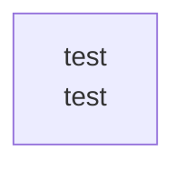

# overall-architecture/group-2

[解析トップへ戻る](../../README.md)

このグループは表示用の区切りです。独立した実行モジュールではありません。

## 要素の説明

### n-test-a94a8f

確認したパス: `test`。配下の登録ファイルは34件。

- `test/avatar.test.mjs`（一覧のみ）
- `test/blocks.test.mjs`（一覧のみ）
- `test/comment-http.test.mjs`（一覧のみ）
- `test/comment-reply.test.mjs`（一覧のみ）
- `test/core.test.mjs`（一覧のみ）
- `test/effects.test.mjs`（一覧のみ）
- `test/engine.test.mjs`（一覧のみ）
- `test/game.test.mjs`（一覧のみ）
- `test/helpers.mjs`（一覧のみ）
- `test/http-obs.test.mjs`（一覧のみ）
- `test/layer-avatar.test.mjs`（一覧のみ）
- `test/noa-avatar-v4.test.mjs`（一覧のみ）
- `test/programme.test.mjs`（一覧のみ）
- `test/providers.test.mjs`（一覧のみ）
- `test/rc2-http.test.mjs`（一覧のみ）
- `test/rc2-regression.test.mjs`（一覧のみ）
- `test/release.test.mjs`（一覧のみ）
- `test/remote-flow.test.mjs`（一覧のみ）
- `test/remote.test.mjs`（一覧のみ）
- `test/setup-flow.test.mjs`（一覧のみ）
- `test/show-logger.test.mjs`（一覧のみ）
- `test/supertonic-launcher.py`（一覧のみ）
- `test/talk.test.mjs`（一覧のみ）
- `test/voice-adapters.test.mjs`（一覧のみ）
- `test/voice-audio.test.mjs`（一覧のみ）
- `test/voice-avatar.test.mjs`（一覧のみ）
- `test/voice-director.test.mjs`（一覧のみ）
- `test/voice-engine.test.mjs`（一覧のみ）
- `test/voice-gemini.test.mjs`（一覧のみ）
- `test/voice-http.test.mjs`（一覧のみ）
- `test/voice-library.test.mjs`（一覧のみ）
- `test/voice-router.test.mjs`（一覧のみ）
- `test/voice-scripts.test.mjs`（一覧のみ）
- `test/voice-stream.test.mjs`（一覧のみ）

[詳細な図と説明を見る](n-test-a94a8f/README.md)

